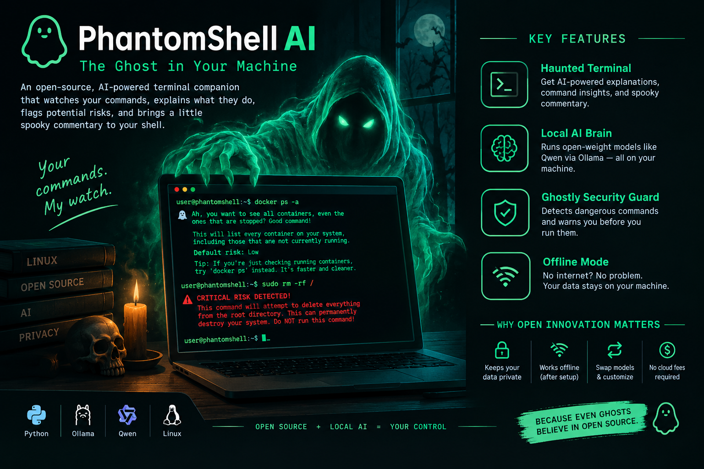

# 👻 PhantomShell AI — The Ghost in Your Machine



**A local-first, open-weight AI terminal companion that explains Linux commands, whispers warnings about risky operations, and adds a little Halloween atmosphere.**

Built for the Hacktoberfest Open-Source AI Challenge: **Ghost in the Machine**.

## What it does

- Explains shell commands in beginner-friendly language using a local Ollama model.
- Runs simple local pattern checks for potentially destructive commands.
- Offers a spooky, friendly terminal interface.
- Supports `--rules-only` mode for rule-based checks without calling the AI.
- Keeps prompts on your own machine when using local Ollama.
- **Never executes the commands it analyzes.** This is intentional: the tool is an advisor, not a shell wrapper.

## Architecture

```text
You enter a command
        |
        v
PhantomShell CLI (Python)
        |
        +--> Local safety-pattern scanner
        |
        +--> Ollama API on localhost
                    |
                    v
              Open-weight model
                    |
                    v
          Explanation + safer advice
```

## Requirements

- Python 3.10 or newer
- [Ollama](https://ollama.com/) installed locally for AI-powered explanations
- Enough RAM for your chosen model (smaller quantized models are easier to run)

## Quick start on Ubuntu Linux

### 1. Install Python tools

```bash
sudo apt update
sudo apt install -y python3 python3-venv curl
```

### 2. Install Ollama

Follow the current official instructions at https://ollama.com/download/linux.

Start Ollama if it is not already running:

```bash
ollama serve
```

Keep that terminal open if your installation does not run Ollama as a service.

### 3. Download a model

For a modest local model, try:

```bash
ollama pull qwen2.5:3b
```

You can choose another model supported by your Ollama installation. Model availability, memory use, and license terms vary; check the model card before redistributing it or using it commercially.

### 4. Run PhantomShell

In another terminal, go to this project directory:

```bash
python3 phantomshell.py
```

Try a single command:

```bash
python3 phantomshell.py "docker ps -a"
python3 phantomshell.py "sudo rm -rf /"
```

The second example should trigger a warning. **Do not run destructive commands to test this project.** PhantomShell only analyzes the text you provide.

### 5. Rule-only mode

This mode does not contact Ollama:

```bash
python3 phantomshell.py --rules-only "git reset --hard"
```

It is useful for a quick demonstration or when the model server is unavailable. Rule checks are incomplete and cannot establish that a command is safe.

## Offline behavior

After you have downloaded Ollama, the model, and any needed dependencies, inference can run locally without sending prompts to a cloud AI service. The first-time setup requires internet access unless you transfer the software and model files to the machine yourself. This project does not promise that every installation or dependency is fully offline by default.

## Configuration

Use a different Ollama model:

```bash
python3 phantomshell.py --model llama3.2:3b "ls -lah"
```

Or set an environment variable:

```bash
export PHANTOMSHELL_MODEL="qwen2.5:3b"
export OLLAMA_URL="http://localhost:11434"
```

## Example session

```text
👻 phantom> docker ps -a

🕯️ The ghost is examining: 'docker ps -a'

🧠 THE GHOST SAYS
This lists all Docker containers, including stopped ones.
The spirits of old containers may still be lingering...
```

Exact AI wording will vary by model.

## Safety and limitations

- PhantomShell does not execute shell commands, modify files, or invoke a shell.
- The scanner uses simple patterns; it can miss dangerous commands and can flag harmless ones.
- A clean scan is not a safety guarantee. Review commands before running them yourself.
- AI-generated explanations can be incorrect. Verify important operations with trusted documentation.
- Treat command text as potentially sensitive even when using local software; this application sends it to your configured Ollama endpoint. Keep that endpoint local if privacy is your goal.
- Do not paste secrets, access tokens, passwords, or private keys into prompts.

## Project structure

```text
phantomshell-ai/
├── phantomshell.py
├── tests/
│   └── test_phantomshell.py
├── requirements.txt
├── LICENSE
└── README.md
```

## Run tests

No third-party Python packages are needed for the tests.

```bash
python3 -m unittest discover -s tests -v
```

## Why open innovation matters

PhantomShell uses a local open-weight model through Ollama rather than requiring a hosted AI API. This makes the design easier to inspect, adapt, and experiment with; users can change models and keep command prompts on their own machine when configured for local inference. Once the model is downloaded, AI inference does not require a cloud AI account or per-request hosted inference fee, although the computer still consumes electricity and needs adequate resources.

Open models also make the project less dependent on a single hosted provider. Always review each model's license and terms; “open-weight” does not automatically mean unrestricted open-source licensing.

## Roadmap

- Add shell-history import with explicit user consent.
- Add a configurable risk-rule file.
- Add JSON output for CI and automation workflows.
- Add tests for more command patterns.
- Add a small local web UI for an interactive haunted-terminal demo.

## Contributing

Issues and pull requests are welcome. Please include tests for new risk patterns and never add code that silently executes user-supplied commands.

## License

MIT. See [LICENSE](LICENSE).
